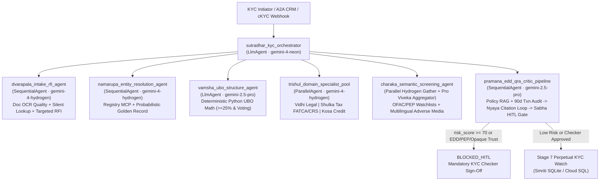

# Arthashastra — Agentic KYC & Entity Resolution Copilot

A modular, runnable **Multi-Agent Commercial Banking KYC & Entity Resolution Copilot** built with **Google Agent Development Kit (`google-adk`)** and **Google GenAI (`google-genai`)**.

Designed around **simplicity, deterministic regulatory auditability, and zero-hallucination compliance controls**, the codebase draws its naming and architectural vocabulary from classical Indian texts on statecraft, treasury governance, and proof-based inquiry — notably Kautilya's *Arthashastra*, *Nyaya* epistemology (*Pramana*), and the *Upanishads*.

---

## 1. Commercial KYC Problem Statement

Commercial and corporate banking Know Your Customer (KYC) onboarding suffers from four structural bottlenecks:
- **Intake & Document Dropout**: 60% of onboarding time is lost to Relationship Manager (RM)-to-client Request for Information (RFI) ping-pong and unreadable or expired scans.
- **Registry Fragmentation**: Domestic and offshore corporate registries require manual normalization and fuzzy entity reconciliation.
- **Cascading UBO Complexity**: Multi-tier holding chains (e.g., UK operating company -> Delaware LLC -> Cayman Islands parent) and Class-B voting-rights overrides breach 24-hour SLAs and cannot safely be computed by LLM mental math.
- **Screening False Positives & Audit Defensibility**: Legacy name-only watchlist rules create >90% false-positive alert fatigue, while Enhanced Due Diligence (EDD) Qualitative Risk Assessments (QRAs) require 100% verifiable source citations and mandatory Human-in-the-Loop (HITL) governance.

---

## 2. Multi-Agent Architecture & Strategic Model Routing



### Heritage Naming Glossary (Indian Texts, History & Philosophy)

| Identifier | Classical Inspiration | Architectural Role |
| :--- | :--- | :--- |
| **Arthashastra** | Kautilya's (~300 BCE) treatise on statecraft & treasury auditing | System compliance constitution & Bank KYC Policy RAG |
| **Sutradhar** | Master director/string-holder in classical Indian drama | `sutradhar_kyc_orchestrator` (Root ADK coordinator, Gemini 4 Neon) |
| **Dvarapala** | Threshold gatekeeper | `dvarapala_intake_rfi_agent` (Document OCR quality, Silent Lookup, Targeted RFI) |
| **Namarupa** | Upanishadic concept of "name & form" | `namarupa_entity_resolution_agent` (Registry MCP & Golden Record resolution) |
| **Vamsha** | Genealogical lineage tree | `vamsha_ubo_structure_agent` (Deterministic cascading UBO ownership calculator) |
| **Trishul** | Three-pronged trident | `trishul_domain_specialist_pool` (`ParallelAgent`: *Vidhi* Legal, *Shulka* Tax, *Kosa* Credit) |
| **Charaka / Viveka** | Intelligence examiner / Discernment | `charaka_semantic_screening_agent` (Watchlist + Adverse Media false-positive suppression) |
| **Pramana / Nyaya** | Valid proof / Logical scrutiny | `pramana_edd_qra_critic_pipeline` (Policy RAG + Source Citation Critique `LoopAgent`) |
| **Sabha** | Council of senior elders | Mandatory Human-in-the-Loop (HITL) KYC Checker sign-off gate |
| **Smriti** | Enduring institutional memory | `SmritiDigitalTwinStore` (SQLite + Cloud SQL / Vertex AI Search adapters) |
| **Sankshepa** | Concise distillation | ADK `EventsCompactionConfig` + >12k token sliding-window compactor |
| **Vayu** | Swift unimpeded wind | Non-blocking `asyncio.create_task` background memory consolidation |
| **Kavach** | Protective armor | Dual-mode active PII redactor (Google Cloud DLP + deterministic regex) |
| **Dharma** | Righteous governance duty | `DharmaPolicyPlugin` + ADK `before_tool_callback` / `after_tool_callback` |
| **Shilalekh** | Immutable stone inscription | `structlog` structured JSON intent-vs-outcome audit logger |
| **Drishti** | End-to-end focused vision | OpenTelemetry distributed tracing spans (InMemory + Cloud Trace) |
| **Mudra** | Royal signet seal | Google Cloud Secret Manager loader with graceful env fallback |

---

## 3. Repository Structure

```text
agentic-kyc-copilot/
├── README.md
├── pyproject.toml
├── .env.example
├── .github/workflows/ci.yml
├── data/
│   ├── corporate_registries.json         # Synthetic UK Companies House, Delaware, Cayman registries
│   ├── watchlists_and_adverse_media.json # Synthetic OFAC/PEP watchlists & multilingual news
│   ├── transactions_90d.json             # 90-day corporate transaction history baselines & spikes
│   └── kyc_governance_policy.md          # Arthashastra Bank KYC Risk Governance Policy (RAG source)
├── eval/
│   └── golden_dataset.json               # 5-case commercial KYC golden evaluation dataset
├── infra/
│   ├── main.tf                           # GCP APIs, IAM SA, Secret Manager, Cloud SQL, BQ, Cloud Run
│   ├── variables.tf
│   └── outputs.tf
├── kyc_copilot/
│   ├── agent.py                          # ADK root_agent & kyc_app (EventsCompactionConfig + Plugin)
│   ├── constitution.py                   # System instructions & Gemini 4 Neon / Hydrogen / Pro routing
│   ├── sutradhar_harness.py              # Deterministic 7-stage pipeline runner & Stage 7 cKYC hook
│   ├── a2a_server.py                     # FastAPI Agent-to-Agent (A2A) & cKYC webhook server
│   ├── config/                           # Mudra Secret Manager vault (mudra_secrets.py / secrets.py)
│   ├── models/schemas.py                 # Strict Pydantic v2 schemas + ToolResultEnvelope[T]
│   ├── tools/                            # All 10 verb-specific tools with Google docstrings & recovery
│   ├── sub_agents/                       # 6 modular ADK sub-agents (Sequential, Parallel, Loop, LLM)
│   ├── memory/                           # Smriti SQLite/RAG store, Sankshepa compaction, Vayu async tasks
│   ├── callbacks/                        # Kavach PII redactor & Dharma ADK callbacks / BasePlugin
│   └── observability/                    # Shilalekh structlog JSON logger & Drishti OTel tracing
└── tests/
    ├── test_tools_and_guardrails.py      # Unit tests for tools, schemas, PII, compaction, async, tracing
    └── test_eval_suite.py                # 5-case golden evaluation suite + ADK topology + A2A tests
```

---

## 4. Quickstart & ADK / CLI Usage

### 4.1 Local Setup & Verification (Zero External Credentials Required)

```bash
python3 -m venv .venv
source .venv/bin/activate
pip install -e ".[dev]"

# Run the complete unit & 5-case golden evaluation suite
pytest -v
```

### 4.2 Interactive ADK Web / CLI Runner

Configure `.env` from `.env.example` (never commit `.env`), then launch via the Google ADK CLI:

```bash
cp .env.example .env
adk web .
# Or run interactively in the terminal:
adk run kyc_copilot
```

### 4.3 Agent-to-Agent (A2A) FastAPI Server

```bash
uvicorn kyc_copilot.a2a_server:app --host 0.0.0.0 --port 8080
```

### 4.4 Provisioning GCP Infrastructure & Vertex AI Deployment

```bash
cd infra
terraform init
terraform plan -var="project_id=<your-gcp-project-id>"
terraform apply -var="project_id=<your-gcp-project-id>"

# Deploy the ADK agent to Vertex AI Agent Engine using the ADK CLI:
adk deploy agent_engine \
  --project="<your-gcp-project-id>" \
  --region="europe-west2" \
  kyc_copilot
```

---

## 5. 95-Point AgentOps Code Review Matrix Traceability

| Category (Points) | Criterion (5 pts each) | Implementation Evidence | Automated Verification |
| :--- | :--- | :--- | :--- |
| **1. Tool & Interface Design (20)** | Comprehensive Tool Docstrings | All 10 tools in `kyc_copilot/tools/*.py` with Google-style `Args:` / `Returns:` docstrings | `test_all_ten_tools_have_verb_specific_names_and_google_docstrings` |
| | Descriptive Naming | 10 verb-specific tools (`assess_uploaded_document_quality_and_classify`, `calculate_cascading_ubo_ownership_rollup`, etc.) | `test_all_ten_tools_have_verb_specific_names_and_google_docstrings` |
| | Explicit JSON Schemas | Strict Pydantic v2 `ConfigDict(extra="forbid")` models in `kyc_copilot/models/schemas.py` | `test_guided_error_recovery_across_malformed_and_ambiguous_inputs` |
| | Guided Error Handling | `ToolResultEnvelope[T]` returning actionable `recovery_instruction` without unhandled crashes | `test_guided_error_recovery_across_malformed_and_ambiguous_inputs` |
| **2. Context & Memory (20)** | Robust System Instructions | `ARTHASHASTRA_CORE_CONSTITUTION` & role instructions in `kyc_copilot/constitution.py` | `test_adk_multi_agent_topology_and_strategic_model_routing` |
| | History Compaction | ADK `EventsCompactionConfig` + `SankshepaHistoryCompactor` (>12k tokens preserving `snapshot_id`s) in `kyc_copilot/memory/compaction.py` | `test_history_compaction_over_12k_tokens_preserves_all_snapshot_ids` |
| | Persistent Session State | SQLite Digital Twin + TF-IDF Policy RAG with Cloud SQL / Vertex AI Search adapters in `kyc_copilot/memory/persistent_store.py` | `test_async_memory_consolidation_and_cross_turn_persistence`, `test_policy_rag_retrieves_relevant_governance_rules` |
| | Async Memory Operations | Non-blocking `asyncio.create_task` background persistence in `kyc_copilot/memory/async_consolidator.py` | `test_async_memory_consolidation_and_cross_turn_persistence` |
| **3. Orchestration & Logic (20)** | Multi-Agent Patterns | ADK Coordinator (`LlmAgent`), `SequentialAgent`, `ParallelAgent`, and `LoopAgent` across `kyc_copilot/agent.py` & `sub_agents/` | `test_adk_multi_agent_topology_and_strategic_model_routing`, `test_golden_case_02_*` |
| | Strategic Model Routing | `gemini-4-neon` (root coordinator), `gemini-4-hydrogen` (fast intake/resolution/skills), `gemini-2.5-pro` (UBO/EDD/critique) | `test_adk_multi_agent_topology_and_strategic_model_routing` |
| | Guardrails & Policy Plugins | `DharmaPolicyPlugin(BasePlugin)` + `verify_pramana_citations` self-eval in `kyc_copilot/callbacks/guardrails.py` | `test_citation_critique_self_eval_and_secret_manager_fallback` |
| | Human-in-the-Loop Hooks | Mandatory programmatic `BLOCKED_HITL` stop (`risk_score >= 70`) in `submit_high_risk_case_for_checker_signoff` | `test_golden_case_05_high_risk_pep_sanctions_pii_redaction_and_hitl_stop` |
| **4. Observability & Tracing (20)** | Structured JSON Logging | `structlog` JSON processor (`Shilalekh`) in `kyc_copilot/observability/shilalekh_logger.py` (zero bare `print()`) | `test_kavach_pii_redaction_structured_json_logs_and_otel_spans` |
| | Intent vs. Outcome Capture | ADK `before_tool_callback` (`tool_execution_intent`) & `after_tool_callback` (`tool_execution_outcome`) | `test_kavach_pii_redaction_structured_json_logs_and_otel_spans`, `test_golden_case_05_*` |
| | Distributed Tracing | OpenTelemetry SDK (`Drishti`) linked spans with InMemory + Cloud Trace exporter in `kyc_copilot/observability/drishti_tracing.py` | `test_kavach_pii_redaction_structured_json_logs_and_otel_spans`, `test_golden_case_05_*` |
| | PII Redaction | Dual-mode Cloud DLP + regex scrubber (`Kavach`) before every log and memory write in `kyc_copilot/callbacks/kavach_pii_redactor.py` | `test_kavach_pii_redaction_structured_json_logs_and_otel_spans`, `test_golden_case_05_*` |
| **5. Infrastructure & CI/CD (15)** | Automated Evaluation Suites | 5-case golden commercial KYC dataset (`eval/golden_dataset.json`) + `tests/test_eval_suite.py` in GitHub Actions CI | `pytest -v` (100% pass rate) |
| | Infrastructure as Code | Reproducible Terraform in `infra/main.tf`, `infra/variables.tf`, `infra/outputs.tf` + `adk deploy` CLI docs | `.github/workflows/ci.yml` (`terraform validate`) |
| | Secure Secret Management | Google Cloud Secret Manager loader (`MudraSecretVault`) in `kyc_copilot/config/mudra_secrets.py`, zero hardcoded keys | `test_citation_critique_self_eval_and_secret_manager_fallback` + CI static secret scan |
